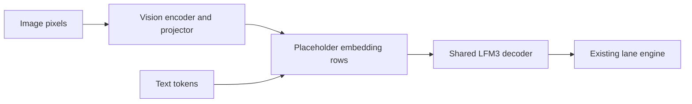

# LFM3 native Metal bring-up

Tracking issue: [#1491](https://github.com/ashhart/TensorFold/issues/1491).

The native Metal engine implements LFM3-1.7B text generation and LFM3-VL-2B image-to-text generation.
Both read the official MLX affine 4-, 6-, and 8-bit checkpoints without converting stored weights.
This is an experimental family port. Device and model receipts cover an M4 Pro; they do not qualify other Apple GPUs.

## Run the models

Build the native engine with the Zig version in `.zig-version` and Xcode's Metal toolchain:

```sh
zig build native -Dcpu=apple_m1
./zig-out/native/bin/tensorfold-native serve LiquidAI/LFM3-1.7B-MLX-4bit --context 8192
./zig-out/native/bin/tensorfold-native serve LiquidAI/LFM3-VL-2B-MLX-4bit --context 8192
```

Replace `4bit` with `6bit` or `8bit` for those exports. A complete local checkpoint folder also works.
The VL checkpoint loads its own image tower. Send images through OpenAI `image_url` content parts.
The default image budget is 256 tokens per request, with at most four images.
Video input is not implemented. JPEG and WebP decoding require the matching shared decoder libraries.

The shared lane engine handles target verification, sampling and concurrent streams.
Convolution history and KV state are kept per stream; partial acceptance restores the accepted row's state.
Raw prompts of at least 256 tokens can build a repeat-cache entry: the first request records interest,
the second keeps a prefix state, and a later repeat resumes it. Image cache identity includes image content and grid.



## Inspect a checkpoint

Use Python 3.11 or newer. The inspector uses the standard library. It resolves a full Hugging Face commit,
reads the config and index, and requests only the safetensors headers. It refuses a server that returns a
complete weight file instead of the requested byte range.

```sh
python3 tools/lfm3/inspect_checkpoint.py LiquidAI/LFM3-1.7B-MLX-4bit --output text4.json
python3 tools/lfm3/inspect_checkpoint.py LiquidAI/LFM3-VL-2B-MLX-4bit --output vl4.json
```

Replace `4bit` with `6bit` or `8bit` to inspect those exports. Pass `--revision COMMIT` to repeat a pinned inspection.
Use `--local-dir MODEL_DIR` instead of a repository name to inspect files already on disk.

## Check the native text layout

Use the Zig version in `.zig-version`.

```sh
zig build --build-file build-lfm3.zig test tf-lfm3-check
./zig-out/bin/tf-lfm3-check text4.json
./zig-out/bin/tf-lfm3-check vl4.json
python3 -m unittest discover -s tools/lfm3 -p 'test_*.py' -v
```

The native checker reads the saved metadata, validates shard header geometry, and checks the LFM3 text decoder's
required names, dtypes, shapes, and byte counts. It performs no projection, GPU allocation, or model inference.
For VL, it checks the text decoder only. A passing result does not validate vision weights or image processing.

The config reader preserves full-attention versus sliding-attention layers, distinct rotary settings, sandwich norms,
and each module's affine width and group size. Unsupported geometry and conflicting quantization declarations fail.

## Checkpoint details

All six inspected MLX exports store the decoder under `language_model.model.*`, including the text-only model.
Each decoder has 594 tensors. Convolution kernels are BF16 with shape `[2048, 7, 1]`.

Text 4/6/8-bit and VL 6/8-bit use affine groups of 64. VL 4-bit uses groups of 32 and an 8-bit embedding override.
The 138 additional VL vision/projector tensors are BF16 in all three exports. Global quantization metadata must not
cause these dense tensors to be treated as packed affine weights.

The header inspections used these revisions:

- Text 4-bit: `d0ca73dcfa70ce18733754a492cdc1fb0123262d`.
- Text 6-bit: `26be898c36b545d625d84ac0761c6c3eb664aef3`.
- Text 8-bit: `ee7667f3cfccb2a41725f91820531823fcabc6b7`.
- VL 4-bit: `c823fade98e35a3d6942ad4d38b1ea15f675cd12`.
- VL 6-bit: `6d71bfae121abedc75f6d531fc7f6ceb4f5e3501`.
- VL 8-bit: `83336d5be3874a2bdd3297bde77b2114dbd3a816`.

## Next gate

Checks run on an Apple M4 Pro with 48 GB RAM, macOS 26.5.1, Zig 0.17.0 and MLX 0.32.4:

- All six checkpoints: 186 served checks and 60 cancellation/recovery checks passed, with no failures or skips.
- Warm repeats reused 896 of 910 prompt tokens and matched the fresh output hash.
- The 1.7B 4-bit exactness suite passed all 68 default cases. The optional long suite was not run.
- All 27 LFM3 operator variants passed their declared gates and limits; all seven planted controls were red as intended.
- The complete repository test target passed 7,231 tests, with 45 skips. Server goldens had no unexpected differences.
- Lean checks added zero findings over the inherited 428.

The complete global GPU runner stops on an unrelated Gemma case that requires M5 tensor units.
Its compiler preflight was exercised with a complete measured rotary receipt; the hardware requirement was not bypassed.
The LFM3 operator and planted-control runs are separate targeted checks, not a claim that the global suite passed.

The independent text reference matched all seven next-token choices in the initial public prompt; its embedding was
byte-identical. On the 256-patch synthetic vision fixture, patch projection and embedding RMS outputs were byte-identical.
Projected image rows had relative RMS difference 0.026 against the independent MLX reference, with differences beginning
in the first encoder layer. This measured case is not an accepted fidelity threshold.

The implementation includes 7-tap convolution, gated full/sliding attention, partial RoPE, sandwich RMS norms,
and the native hybrid vision encoder and projector. It keeps BF16 activation boundaries and FP32 reductions.

Use the real-checkpoint and served checks in addition to the host admission suite:

```sh
zig build tf-lfm3-forward tf-lfm3-vision tf-lfm3-exact -Dcpu=apple_m1
./zig-out/bin/tf-lfm3-exact MODEL_DIR
./zig-out/bin/tf-lfm3-exact MODEL_DIR --long
python3 tools/lfm3/serve_check.py --binary ./zig-out/native/bin/tensorfold-native --model-dir MODEL_DIR --cancel --output served.json
```

The default exactness suite covers 68 prompt, sliding-window, partial-acceptance, shared-stream and snapshot cases.
The long suite adds five checks through 8,193 tokens. The served checker starts and stops only its own loopback server.
It compares complete token hashes, checks actual cache reuse, and tests image content, order and corrupt input for VL.

Independent MLX references live in `tools/lfm3/reference.py` and `vision_reference.py`; they are development tools,
not inference dependencies. Native and MLX reductions can cross different BF16 rounding boundaries.
Record per-layer errors and teacher-forced token differences; same-engine equality alone does not establish model fidelity.

Long-context fidelity, maximum image budgets, stronger nonlinear accumulation witnesses and other Apple generations
remain separate qualification work. Structured output requires the native grammar library; logprobs are not advertised.

Agree model-fidelity and performance acceptance criteria on the tracking issue before claiming release readiness.
